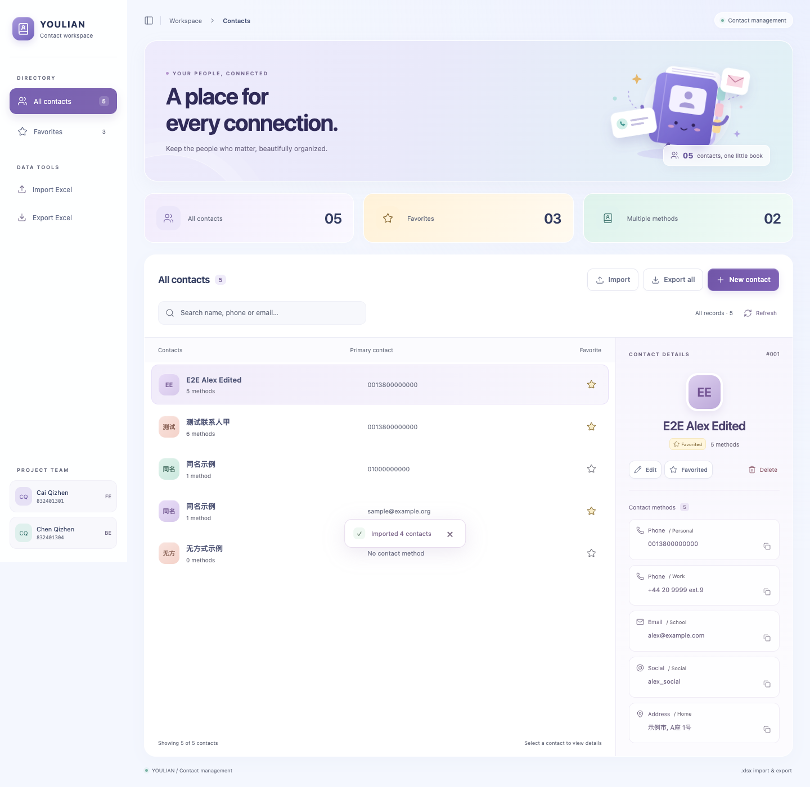
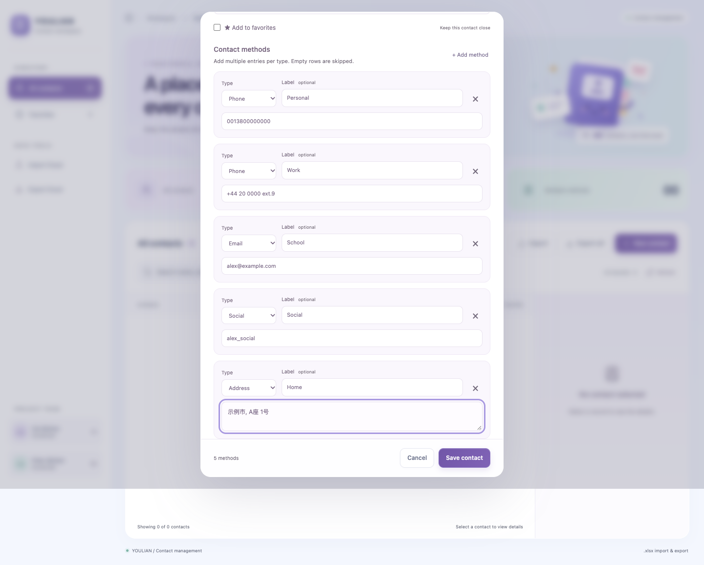
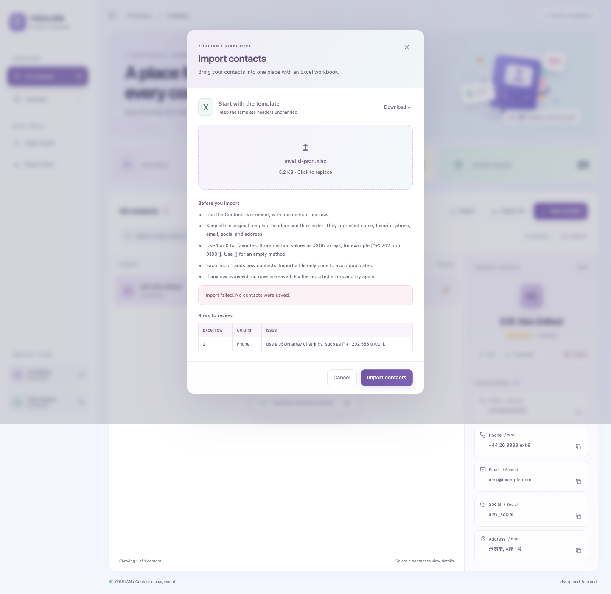
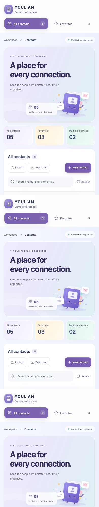
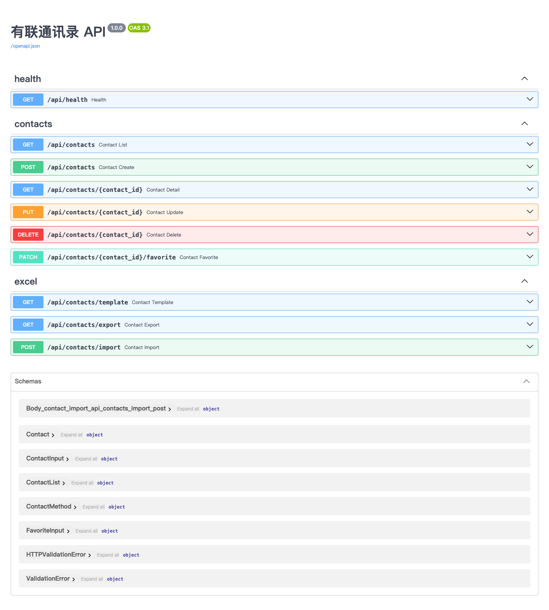

# 结对编程通讯录后端实现记录

> 发布前请填写待确认内容并补齐两人的实际记录。这是后端博客草稿，个人博客仍须本人检查、发布及提交。

| Item | Content |
| --- | --- |
| Course for This Assignment | [Software Engineering FZU–MU](https://bbs.csdn.net/forums/2601_MU_SE_FZU) |
| Team Name | 待两人确认 |
| Assignment Requirements | [Extreme Programming](https://bbs.csdn.net/topics/620593436) |
| Objectives of This Assignment | 完成通讯录、Git 协作、测试与软件工程过程记录 |
| Other References | [FastAPI](https://fastapi.tiangolo.com/)、[SQLite](https://www.sqlite.org/docs.html)、[openpyxl](https://openpyxl.readthedocs.io/) |

## 目录

- [项目与分工](#项目与分工)
- [实现设计](#实现设计)
- [验证和运行](#验证和运行)
- [截图与视频](#截图与视频)
- [提交与贡献](#提交与贡献)
- [问题及解决](#问题及解决)
- [两人的 PSP](#两人的-psp)
- [发布前检查](#发布前检查)

## 项目与分工

[团队仓库](https://github.com/Cai5133/832401301-CaiQizhen-832401304-ChenQizhen) · [代码规范](code-style.md) · [接口契约](api.md)

蔡奇真（832401301）负责 Vue 页面、动态多方式表单、收藏交互、Excel 上传下载和前端适配；陈颀桢（832401304）负责数据模型、持久化、联系人和收藏接口、Excel 解析生成与后端验证。共同负责接口确认、评审、联调和交付证据。

前后端已通过 PR #1 和 PR #2 合并到 main。完整网页支持新增编辑、多方式、收藏、搜索、删除和 Excel 上传下载，已连接真实 SQLite 后端。生产构建由 FastAPI 同端口提供，Nginx 和 systemd 部署配置已准备。

## 实现设计

后端采用 FastAPI、SQLite 和 openpyxl。contacts 保存姓名和收藏状态，contact_methods 通过外键保存同一联系人的任意类型方式，并允许两条 phone。电话号码按字符串处理，国际号码、前导零和分机不会被误转为整数。

新增和整体编辑使用数据库事务。编辑时先验证整个请求，再在同一事务内修改联系人并替换方式；删除通过外键级联移除方式。数据库文件位置固定到 backend 下，可用环境变量更换路径，避免从不同目录启动出现多个数据库。

收藏接口接受明确的 isFavorite 布尔值。重复设置 true 仍保持收藏，刷新和重启后通过 SQLite 读回状态。查询同时支持姓名或方式内容搜索以及 favorite 筛选，固定按 id 排序。

Excel 每人一行，固定六个中文表头。每种方式以 JSON 字符串数组写进对应列，保留同类型多个值，也不误拆含逗号地址。导出内容明确写成文本，避免把等号开头的姓名变成公式。

上传仅接受 .xlsx，设置文件大小、解压体积和行数边界。解析先校验整份文件，收集行号、列名和原因；全部成功后才在一个事务中新增。任何错误整批不写入，同名允许存在。Excel v1 仅保存 value，label 不参与往返。

## 验证和运行

整合版本后端 42 项自动化测试通过，并通过真实 HTTP 的启动、重启、收藏持久化、Excel 往返和异常样例测试。[测试报告](test-report.md) 给出范围和结果；[运行说明](../backend/README.md) 给出从零安装、虚构演示库和启动命令。

Vue 前端 16 项测试和生产构建通过。真实浏览器在同端口生产网页完成新增五条方式、编辑、搜索、收藏筛选、删除、Excel 下载、正常及错误导入，并验证实际重启后数据保留；390px 窄屏无横向溢出。具体步骤与结果见 [整体验收](integration-report.md)。

## 截图与视频











发布到 CSDN 时将截图上传到正文图床，替换本地相对路径。完整运行视频链接：待录制并补充，必须展示全部核心路径，截图不能替代完整视频。

建议演示顺序：启动后端和前端 → 新增含两部电话与邮箱的联系人 → 编辑 → 收藏筛选及取消 → Excel 导出并打开 → 向空库导入 → 错误文件提示 → 重启后数据保留。

## 提交与贡献

仓库历史保留原前端提交，后端按核心 API、Excel、验证交接三个实际阶段提交。发布前在最终 main 上执行：

```bash
git shortlog -sne HEAD
git log --oneline --all
```

前后端 PR 已合并。提交数表和历史截图请按发布时 main 的实际哈希补充；数量会随后续文档提交改变。两人的实际贡献比例待共同确认，合计应为 100%；提交数量不等同于贡献比例。

后端协作 PR、后端版本和最终项目 Release 链接见 [交付状态](delivery.md)。最终项目 Release 须等前后端全部验收后发布。

## 问题及解决

后端需要解决的技术问题包括：一名联系人多种及同类型多条方式、一个 Excel 单元格容纳多个值、导入失败避免半批写入、进程重启后收藏保留。分别通过一对多表、JSON 数组、事务和固定路径 SQLite 处理，并有测试覆盖。

两人在合作中实际遇到的问题及处理过程：待各自记录后补充，不能把设计上的风险预防写成已经发生的协作经历。

## 两人的 PSP

单位为分钟。预计和实际耗时由本人依据真实记录填写，未做项目填 0 并说明；不代填或编造。每篇个人博客都应放这两张表。

### 蔡奇真 832401301

| 活动 | 预计 | 实际 |
| --- | --- | --- |
| 计划与分工 | 待填写 | 待填写 |
| 需求分析与设计 | 待填写 | 待填写 |
| 代码规范与接口约定 | 待填写 | 待填写 |
| 前端编码实现 | 待填写 | 待填写 |
| 代码复审与修改 | 待填写 | 待填写 |
| 测试与前后端联调 | 待填写 | 待填写 |
| 发布文档博客总结 | 待填写 | 待填写 |
| 合计 | 待填写 | 待填写 |

### 陈颀桢 832401304

| 活动 | 预计 | 实际 |
| --- | --- | --- |
| 计划与分工 | 待填写 | 待填写 |
| 需求分析与设计 | 待填写 | 待填写 |
| 代码规范与接口约定 | 待填写 | 待填写 |
| 后端编码实现 | 待填写 | 待填写 |
| 代码复审与修改 | 待填写 | 待填写 |
| 测试与前后端联调 | 待填写 | 待填写 |
| 发布文档博客总结 | 待填写 | 待填写 |
| 合计 | 待填写 | 待填写 |

## 发布前检查

- 前后端完整功能与本地网页联调已通过，见整体验收；发布前按视频顺序再次演示。
- 填写团队名、两人实际提交数量、贡献比例、问题过程和 PSP。
- 补充完整视频与最终运行截图，核验所有链接。
- 相对文档链接替换为 GitHub 对应的公开链接。
- 最终项目 Release 和课程目标 PR 已核实；原帖未列明确上游时向助教确认。
- 两人各自发布 CSDN 博客，待审核可访问后，分别在原帖底部提交本人博客正文 URL。

作业截止为北京时间 2026 年 11 月 17 日 23:59，请预留博客审核时间。云部署配置已准备，正在核对腾讯云免费实例；尚未完成公网验收，不将 localhost 写成云地址。
