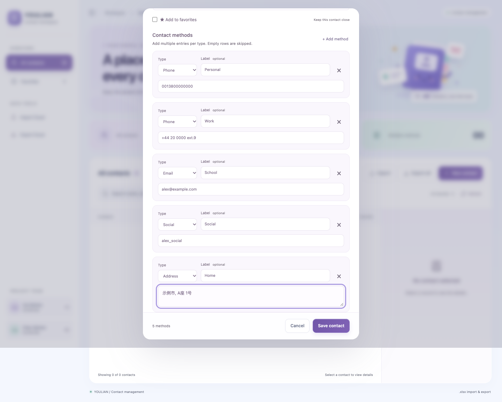
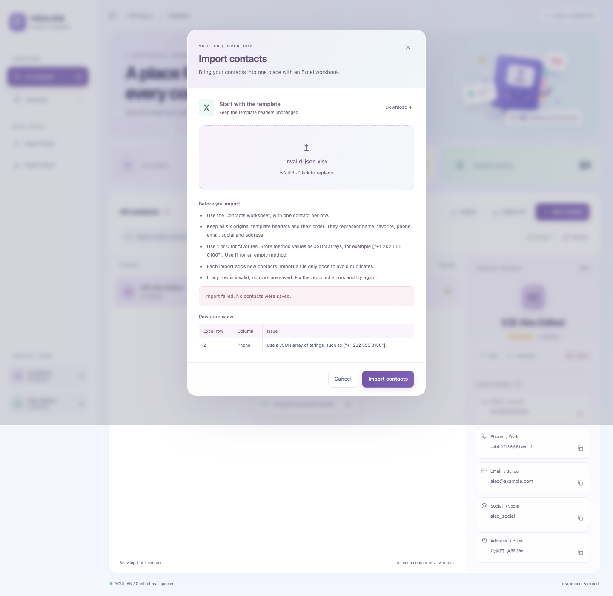
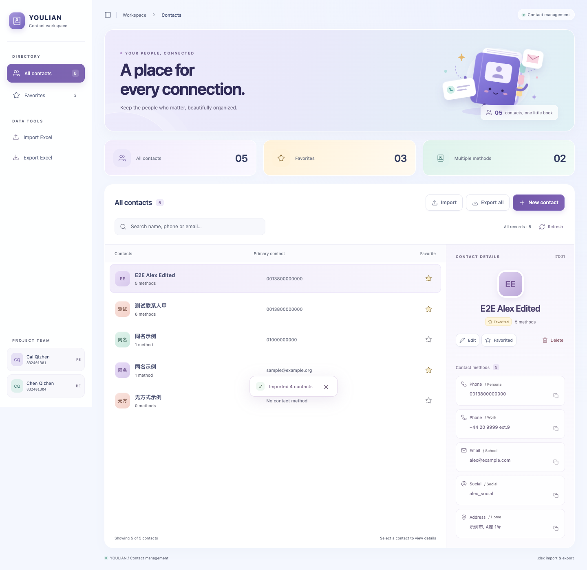
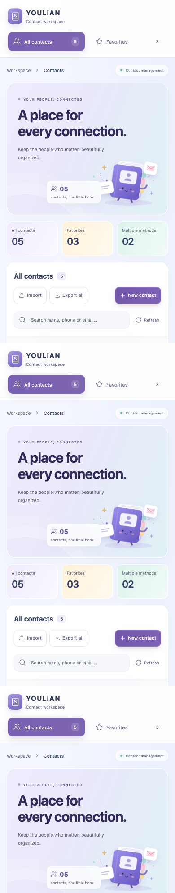

# 前后端整合验收

日期：2026 年 11 月 15 日。前端基于蔡奇真 PR #2，后端基于 PR #1，两项 PR 均已合并到 main。统一为 FastAPI 同端口提供 Vue 生产构建和 /api，未使用虚构 HTTP 接口。

## 已通过

- 前端 16 项测试与 Vite 生产构建通过，后端 42 项测试通过。
- 真实浏览器以 1440px 桌面访问同端口生产网页，从空 SQLite 库新增两条 phone、一条 email、一条 social 和一条 address。
- 网页编辑姓名和第二条电话后仍有 5 条方式；前导零和带分机国际号码保留；社交账号搜索正确。
- 网页收藏、进入收藏筛选、取消收藏后显示空状态，再次收藏成功。
- 真正从网页下载 Excel 和模板；导出文件有 ZIP 工作簿签名。
- 错误电话 JSON 样例展示 Excel 第 2 行 Phone 错误，联系人总数保持不变。
- 正常样例通过网页新增 4 人，导入成功提示条数正确。
- 390px 窄屏页面及新增弹窗无横向溢出；浏览器没有页面脚本异常。
- 真正停止并重新启动 uvicorn 进程，刷新网页仍有 5 人，收藏和 5 条方式保留。
- 删除确认后接口 204，列表和数据库删除成功。
- 清空临时库后，通过网页导入之前导出的文件，恢复 1 位联系人、收藏和全部 5 条方式，电话号码前导零保留。Excel v1 的 label 按契约为空。

验证使用隔离 SQLite 库，测试后停止进程，不会修改正式服务器数据。

## 整合修正

统一前后端 value 最大 2000 字、label 最大 100 字、每人最多 100 项方式，避免从 Excel 导入的合法长字段在网页编辑时被错误拒绝。静态资源在 API 路由之后注册，未知资源 404，数据库文件不通过网页目录暴露。

共享 README 与交接文档冲突按双方实际功能解决，保留双方原代码及提交历史。生产部署使用单服务和持久目录，配置见 deploy 与 [云部署说明](deployment.md)。

## 证据

## 云端状态

2026 年 11 月 16 日已部署并通过公网完整操作、服务重启与服务器整机重启验收。访问 [有联通讯录](http://43.139.206.206/)，具体规格、免费试用到期时间和验证范围见 [云端报告](cloud-report.md)。

完整视频和重要页面截图已录制并作为版本素材提供。两人的真实 PSP、贡献比例、个人博客发布和课程链接提交仍须本人补齐。
